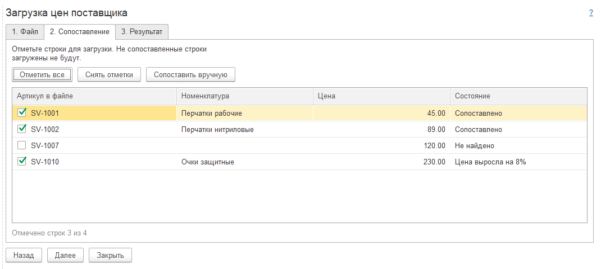

# md-design-skills

Навыки для ИИ-агентов, которые превращают словесное описание формы 1С в её снимки, отрисованные настоящей платформой 1С:Предприятие.

Агент пишет разметку формы для [«Накидки»](https://github.com/crimsongoldteam/md_design) (md_design), сам формирует форму в 1С во временной базе и снимает каждую страницу в PNG. Человек получает готовые экраны для аналитической записки, ТЗ или согласования интерфейса, не открывая 1С. По умолчанию всё происходит невидимо — в веб-клиенте внутри браузера без окна, экран пользователя не занимается.



## Навыки

| Навык | Слой | Что делает |
| ----- | ---- | ---------- |
| [`md-design-prototype`](skills/md-design-prototype/SKILL.md) | Функциональный | Как сделать прототип для пользователя: выяснить экраны, написать разметку по справочнику ловушек, выбрать исполнителя, проверить снимки, оформить результат |
| [`md-design-form-diff`](skills/md-design-form-diff/SKILL.md) | Функциональный | Было / стало для доработки существующей формы: текущая форма из разбора `Form.xml` или скриншотов пользователя, прототип доработки, таблица изменений |
| [`md-design-to-epf`](skills/md-design-to-epf/SKILL.md) | Функциональный | Передача в разработку: разметка согласованного прототипа → внешняя обработка `.epf` с той же формой и снимок собранной формы |
| [`md-design-render-web`](skills/md-design-render-web/SKILL.md) | Исполнитель | Невидимый прогон: свой Apache на `127.0.0.1`, публикация базы-песочницы, Firefox без окна через Playwright, снимки по DOM |
| [`md-design-render-screen`](skills/md-design-render-screen/SKILL.md) | Исполнитель | Прогон в тонком клиенте через окно на экране: эмуляция ввода, снимки с экрана, защита от ввода в чужое окно |

Функциональный навык выбирает исполнителя сам: веб по умолчанию, экран — если нет Node.js или git, или если нужен именно тонкий клиент.

Что умеют вместе:

- прототипы форм, мастеров, АРМ, карточек и диалогов 1С по описанию на естественном языке;
- снимки каждой страницы формы с обрезкой по форме;
- раздел ТЗ на форму: снимки и таблицы полей, команд и проверок, неизвестное — в открытые вопросы;
- состояния экрана (пустой, заполненный, ошибка) одним невидимым запуском;
- распознавание окна ошибки 1С при формировании — остановка с понятным сообщением, а не стартовый экран обработки вместо формы;
- справочник синтаксиса «Накидки» с таблицей ловушек разбора, которых нет в документации инструмента.

Чего не делают: не создают рабочую форму в конфигурации или расширении (`Form.xml`); форма на снимках неживая.

## Состав

```text
skills/
  md-design-prototype/             функциональный навык
    SKILL.md
    references/syntax.md           синтаксис и ловушки разбора
    assets/tz-template.md          шаблон раздела ТЗ
  md-design-form-diff/             было / стало для доработки формы
    SKILL.md
    scripts/form-xml-to-markup.ps1 перевод Form.xml в разметку
  md-design-to-epf/                прототип → внешняя обработка
    SKILL.md
    scripts/markup-to-epf.ps1      вызов: дерево, XML, сборка, снимок
    scripts/tree.mjs               дерево разбора от страницы редактора «Накидки»
    scripts/gen-epf.mjs            XML-выгрузка обработки по дереву
  md-design-render-web/            исполнитель без экрана
    SKILL.md
    scripts/render.ps1             подготовка окружения, Apache, прогон
    scripts/render.mjs             сценарий браузера (Playwright, Firefox)
  md-design-render-screen/         исполнитель с экраном
    SKILL.md
    scripts/render.ps1             тонкий клиент, ввод, снимки с экрана
examples/                          пять примеров: разметка и снимки
tests/regression/                  разметки с ожидаемым исходом
.claude-plugin/                    манифест плагина и каталога для Claude Code
```

## Установка

Навыки оформлены по открытому стандарту [Agent Skills](https://agentskills.io/specification.md).

**Claude Code** — как плагин:

```text
/plugin marketplace add Romandredan/md-design-skills
/plugin install md-design-skills@md-design-skills
```

или копированием папок из `skills/` в `~/.claude/skills/`.

**Другие агенты с поддержкой Agent Skills** (Codex, OpenCode, Cursor и др.) — скопируйте папки из `skills/` в каталог навыков агента. Функциональные навыки ссылаются на исполнителей по имени, поэтому ставить нужно все.

## Требования

- Windows, PowerShell 5.1 или новее, платформа 1С:Предприятие 8.3.
- Для невидимого прогона: Node.js 18+, git, модуль веб-сервера платформы (`bin\wsap24.dll`), Visual C++ Redistributable x64; доступ к github.com, apachelounge.com и npm при первом запуске.
- Для прогона с экраном: тонкий клиент (`1cv8c.exe`), доступ к github.com при первом запуске.

## Что меняется в системе

Всё размещается в `%LOCALAPPDATA%\md-design-sandbox`, права администратора не нужны.

- База-песочница и строка `DisableUnsafeActionProtection=.*md-design-sandbox.*` в пользовательском `%LOCALAPPDATA%\1C\1cv8\conf\conf.cfg` (прежние строки сохраняются). Защита от опасных действий снимается только для баз с `md-design-sandbox` в пути.
- Веб-исполнитель: Apache, Firefox для Playwright, сборка «Накидки». Apache запускается только на время прогона, слушает `127.0.0.1` и останавливается после. При первом запуске брандмауэр Windows может спросить про доступ `httpd.exe` к сетям — разрешать не нужно.
- Экранный исполнитель: на время прогона (около минуты) занимает экран окном 1С.

## «Накидка» в веб-клиенте

Выпуск «Накидки» 0.16.4 в веб-клиенте не работает. Исправление предложено авторам: [issue #216](https://github.com/crimsongoldteam/md_design/issues/216), [PR #217](https://github.com/crimsongoldteam/md_design/pull/217). До его принятия веб-исполнитель собирает обработку из форка [Romandredan/md_design](https://github.com/Romandredan/md_design/tree/fix/web-client-json) (ветка `fix/web-client-json`); экранный исполнитель берёт официальный выпуск.

## Ограничения

- Проверено на платформе 8.3.27 и «Накидке» 0.16.4.
- Снимаются страницы верхнего уровня.
- Окно ошибки 1С исполнители распознают, но тихие ошибки разбора (строка, ставшая другим элементом, не применённое свойство) видны только на снимках — их нужно просматривать, и функциональный навык требует этого от агента.

## Благодарности

«Накидка» — проект [crimsongoldteam/md_design](https://github.com/crimsongoldteam/md_design) под лицензией MIT; этот репозиторий её не содержит и скачивает обработку из официальных выпусков или собирает из исходников форка.

## Лицензия

[MIT](LICENSE)
