# Примеры

Каждый пример — разметка `form.txt` (в раскадровке — несколько разметок) и снимки `img/`, полученные исполнителем:

```powershell
powershell -NoProfile -ExecutionPolicy Bypass -File ..\skills\md-design-render-screen\scripts\render.ps1 `
  -Markup .\02-kartochka-partnera\form.txt -OutDir .\02-kartochka-partnera\img -Prefix page
```

## 1. Диалог переноса даты отгрузки

Форма без страниц: поле даты, поле со списком, флажок, акцентная кнопка (`ЦветФона = Золотой`). Разметка — [01-dialog-perenos-daty/form.txt](01-dialog-perenos-daty/form.txt).

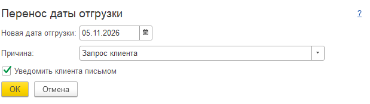

## 2. Карточка партнёра

Командная панель над закладками, три страницы, однострочная группа, переключатель, таблица, многострочное поле. ИНН и КПП заданы строкой (`{Тип = Строка(12)}`), иначе разбор делает их числами с разделителями разрядов. Разметка — [02-kartochka-partnera/form.txt](02-kartochka-partnera/form.txt).

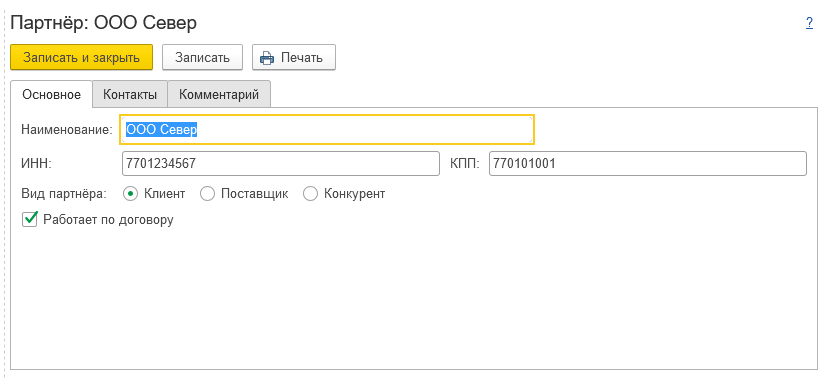

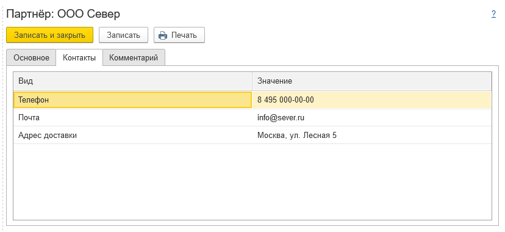

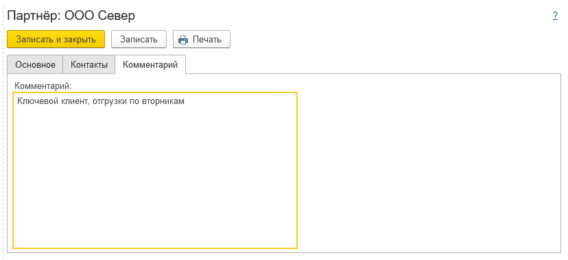

## 3. Мастер загрузки цен поставщика

Мастер из трёх шагов с общей панелью «Назад / Далее / Закрыть»: выбор файла, таблица сопоставления с флажками и командами отметки, итог с кнопкой действия. Разметка — [03-master-zagruzki-cen/form.txt](03-master-zagruzki-cen/form.txt).

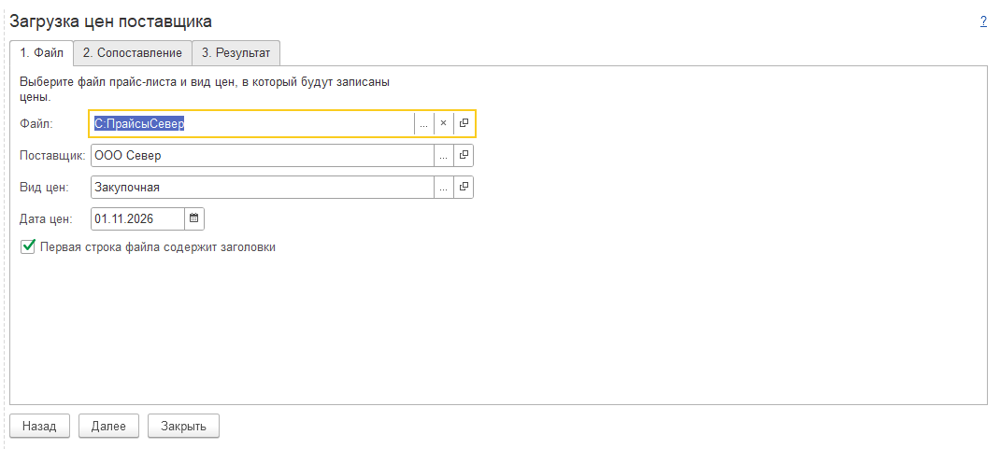

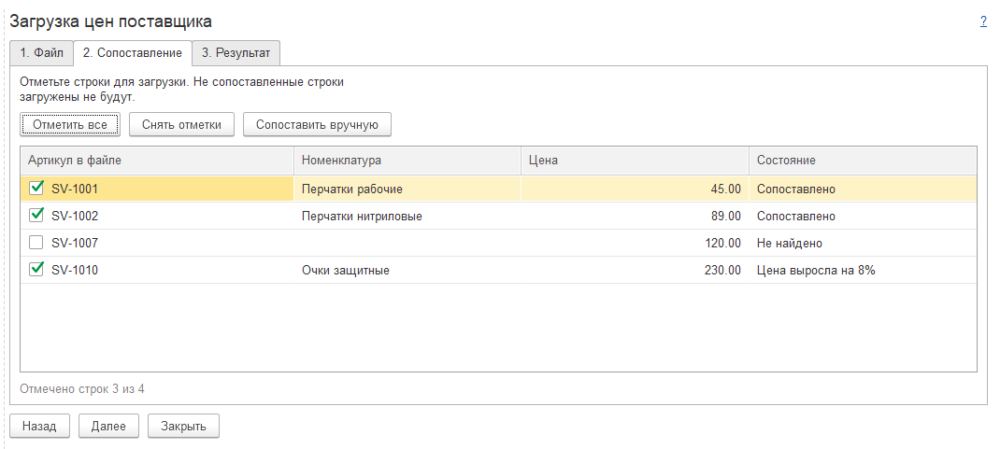

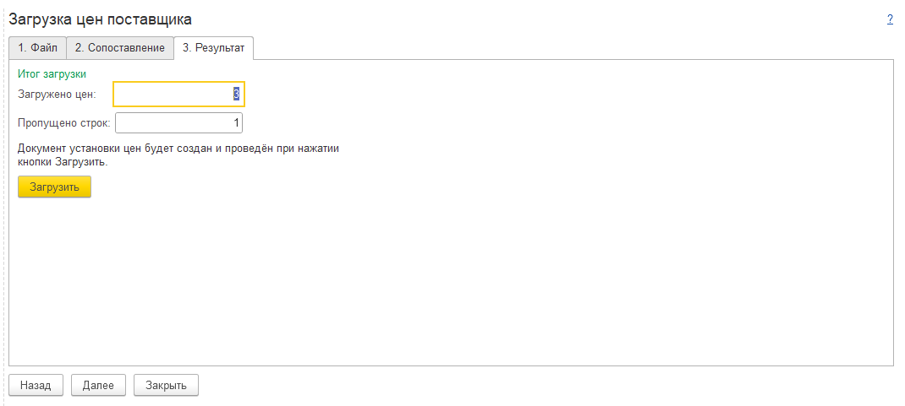

## 4. АРМ кладовщика, приёмка

Две колонки групп, выключатель, тумблер, командная панель внутри колонки, дерево заданий (на форме свёрнуто до корневых строк), предупреждение цветом. Разметка — [04-arm-priemki/form.txt](04-arm-priemki/form.txt).

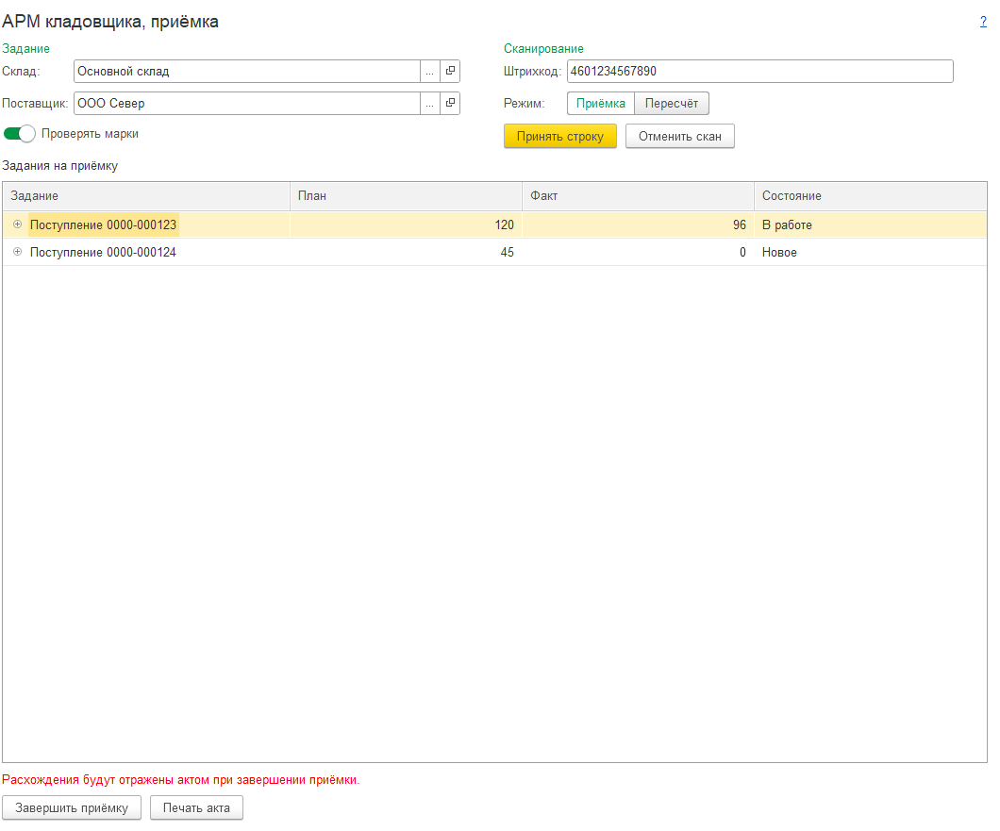

## 5. Раскадровка: диалог переноса даты в трёх состояниях

Один экран — три разметки с минимальными отличиями, снятые одним вызовом веб-исполнителя:

```powershell
$d = ".\05-raskadrovka-perenosa-daty"
powershell -NoProfile -ExecutionPolicy Bypass -File ..\skills\md-design-render-web\scripts\render.ps1 `
  -Markup "$d\01-pusto.txt;$d\02-zapolneno.txt;$d\03-oshibka.txt" -OutDir "$d\img"
```

Недоступные кнопка и флажок — свойство `{Доступность = Ложь}`; пустое поле даты — `{Тип = Дата(Дата)}`, иначе без значения оно стало бы строковым.

**1. Диалог открыт.** Поля пустые, «ОК» недоступна, пока не заполнена дата.

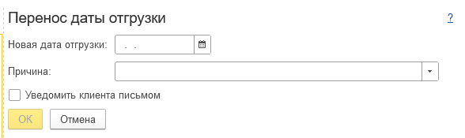

**2. Дата и причина заполнены.** «ОК» доступна.

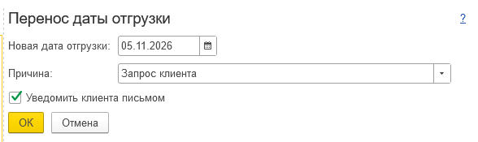

**3. Дата в прошлом.** Сообщение под полями, «ОК» и уведомление недоступны, пока дата не исправлена.

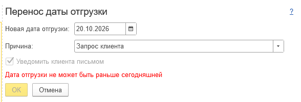
